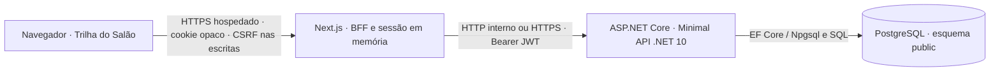

# Repasse técnico do App de Caixa

**23 de novembro de 2026 · Engenharia, QA e operação**

O App de Caixa é o MVP de gestão de caixa de um salão. O Trilha do Salão atende gerente, caixa e profissional. A operação registra comandas e recebimentos, concilia o dinheiro da gaveta e apura comissões por quinzena. A API também registra fiado e sua liquidação.

## Versão e evidências

| Estado | Evidência |
| --- | --- |
| Commit local de referência | `8a08d453763bb191dee1156f644da758810e840b`, último commit do checkout para frontend e backend |
| Versões em uso | O responsável informou que os dois serviços usam os últimos commits. A referência de cada implantação ainda precisa ser conferida no painel do provedor. |
| Alterações locais já existentes | `backend/Dockerfile`, `backend/README.md`, `backend/src/AppDeCaixa.Api/Program.cs` e `backend/src/AppDeCaixa.Infrastructure/Persistence/Migrations/20261029204037_ExistingSchemaAuthAndOrderLinks.cs`. O prompt de repasse também estava fora do commit. |
| Impacto no deploy | O modo `--migrate` e o `CMD` com caminho absoluto aparecem nessas alterações locais. A mudança da migration inicial também está no checkout local. Confirme a revisão da imagem antes de usar o novo comando. |
| Verificado nesta máquina | Build .NET, 62 testes xUnit, build Next.js, validação dos dois arquivos Compose e teste da API e de restore com PostgreSQL descartável. Veja a matriz de QA para condições e pendências. |
| Configuração documentada | Railway para o fluxo da API e banco PostgreSQL acessível pela API. Origem pública, hospedagem do frontend, topologia, destino do banco e responsáveis operacionais precisam de confirmação. |

## Arquitetura e limites



| Projeto | Responsabilidade |
| --- | --- |
| `AppDeCaixa.Api` | Rotas HTTP, configuração, autenticação, autorização, rate limiting, health check e injeção de dependências. A composição está em `backend/src/AppDeCaixa.Api/Program.cs`. |
| `AppDeCaixa.Application` | Casos de uso, validações, contratos de repositório e coordenação de operações. |
| `AppDeCaixa.Domain` | Regras de dinheiro, caixa, comanda, serviços e comissão. |
| `AppDeCaixa.Infrastructure` | EF Core/Npgsql, mapeamentos, migrations e repositórios com SQL para consultas e operações transacionais. |

A direção é API → Application e Infrastructure, Infrastructure → Application/Domain e Application → Domain. `backend/tests/AppDeCaixa.Domain.Tests/ArchitectureTests.cs` verifica que o projeto Domain não declara dependências de ASP.NET Core, EF Core ou Npgsql.

### Identidade, empresa e permissões

`POST /api/auth/token` aceita e-mail e senha, verifica hash com o `PasswordHasher` do ASP.NET Core e emite JWT HS256 de 15 minutos. A API valida assinatura, emissor, audiência e validade. O token carrega ID do ator, papel, `company_id` e, quando vinculado, `employee_id`. Os endpoints obtêm a empresa e o ator do token e os repositórios filtram as operações pela empresa. Em `GET /api/me/commissions`, a identidade do profissional também vem do token. O cliente escolhe o período. Contas `Employee` precisam de um colaborador ativo da mesma empresa no cadastro. A criação de usuários tem rota administrativa de gerente. Referências em `backend/src/AppDeCaixa.Api/Authentication/JwtAccessTokenIssuer.cs`, `backend/src/AppDeCaixa.Api/Users/UserEndpoints.cs`, `backend/src/AppDeCaixa.Api/Commissions/EmployeeCommissionEndpoints.cs` e `backend/src/AppDeCaixa.Infrastructure/Authentication/UserCredentialRepository.cs`.

| Capacidade da API | Manager | Cashier | Employee |
| --- | :---: | :---: | :---: |
| Abrir, consultar e fechar caixa, movimentar e conciliar | Sim | Sim | — |
| Consultar serviços, colaboradores e formas de pagamento | Sim | Sim | — |
| Criar usuários, colaboradores e serviços | Sim | — | — |
| Abrir e consultar comanda, lançar serviço, receber à vista | Sim | Sim | — |
| Autorizar fiado com justificativa | Sim | — | — |
| Consultar dívidas e registrar liquidação | Sim | Sim | — |
| Prévia e pagamento de comissão por colaborador | Sim | — | — |
| Consultar comissão própria | — | — | Sim |

### Sessão no frontend e cobertura da interface

O frontend usa Next.js 16 App Router, React 19 e TypeScript. `frontend/src/app/page.tsx` monta a aplicação em `frontend/src/components/salon-app.tsx`. `POST /api/auth/login` no Next verifica `Origin`, chama `POST /api/auth/token` na API e armazena o JWT, o usuário, o vencimento e o token CSRF em memória. O navegador recebe o cookie opaco `salon_session` com `HttpOnly`, `Secure`, `SameSite=Strict` e expiração alinhada à sessão. `GET /api/auth/session` restaura usuário e CSRF após recarga. `POST /api/auth/logout` valida origem e, havendo sessão, CSRF, revoga a sessão local e expira o cookie.

Em `/api/bff/[...path]`, a lista de caminhos e métodos restringe o encaminhamento. Nas escritas autenticadas o BFF exige origem exata e cabeçalho `X-CSRF-Token`. Um 401 vindo da API invalida a sessão no BFF e expira o cookie. Reiniciar o Next apaga a memória. Reiniciar a API em Development com chave efêmera invalida JWTs daquele processo. A sessão não é renovada automaticamente. Para distribuir o Next entre réplicas mantendo o login, é preciso compartilhar as sessões. Referências em `frontend/src/app/api/auth/`, `frontend/src/app/api/bff/[...path]/route.ts`, `frontend/src/lib/session-store.ts` e `backend/src/AppDeCaixa.Api/Program.cs`.

| Superfície | Fluxos |
| --- | --- |
| Interface | Login/logout, abrir caixa, lançar comanda e serviço, checkout à vista, fechar e conciliar, prévia/pagamento de comissão do gerente e comissão própria do empregado. |
| Interface com falha de contrato | Fiado aparece para `Manager`, mas `recordPayment` envia apenas `paymentMethodId`. `OrderPaymentService` retorna 400 sem `note`. A API aceita a operação com o corpo completo. |
| BFF sem tela correspondente | Rotas de listagem/escrita de movimentos de caixa e criação de colaborador são permitidas pelo BFF. Há leitura de colaboradores no fluxo de comanda. |
| API direta | Bootstrap, criação de usuário e serviço, lista e liquidação de dívidas. |

`salon_active_order` guarda ID da comanda e ID do usuário em `sessionStorage` por aba. Ao recarregar, o navegador consulta a API para recuperar a comanda. A lista de comandas abertas por empresa ainda não existe no contrato HTTP. Referências em `frontend/src/components/salon-app.tsx`, `frontend/src/app/api/bff/[...path]/route.ts`, `backend/src/AppDeCaixa.Api/ServiceOrders/ServiceOrderEndpoints.cs` e `backend/src/AppDeCaixa.Application/Payments/OrderPaymentService.cs`.

## Um dia de operação

1. O Caixa abre uma sessão com **R$ 200**. O banco garante uma sessão aberta por empresa com índice único parcial para `data_fechamento IS NULL`.
2. Abre uma comanda para **Cliente Exemplo**. Lança um serviço de **R$ 90** com a profissional **Joana Teste** e registra preço final de **R$ 75** com justificativa. O item guarda o preço de catálogo, o valor cobrado, o colaborador, o percentual de comissão e a auditoria do ajuste. A comanda pertence à sessão aberta.
3. Recebe **R$ 75 em Dinheiro** para a primeira comanda e **R$ 40 em Pix** em outra. Para uma terceira, o Gerente registra **R$ 60 em Fiado** com justificativa via API. O checkout fecha a comanda com um lançamento integral em Pix, Dinheiro, cartão de débito, cartão de crédito ou Fiado. Para fiado, grava a origem da dívida, o ator e o horário.
4. Pelo endpoint de liquidação, o Caixa recebe **R$ 10 em Dinheiro + R$ 15 no débito** para o fiado. O saldo fica em **R$ 35**. A dívida em aberto é o valor original menos as alocações de liquidação. A origem continua marcada como fiado inclusive após quitação. Cada alocação pertence ao caixa que recebeu, mesmo quando a comanda foi aberta e encerrada em outro caixa.
5. Registra **R$ 20 de CashIn** e **R$ 30 de CashOut**, com motivo, pelos endpoints de movimentos. O esperado na gaveta é **200 + 75 + 10 + 20 − 30 = R$ 275**. Com **R$ 270** contados, a diferença é **−R$ 5**. Pix e cartões ficam em totais próprios. `fiadoDebt` da conciliação indica **R$ 60 originados** no exemplo, enquanto a lista de dívidas mostra o saldo de **R$ 35**. `fiadoSettlements` informa os **R$ 25 recebidos** que já compõem os totais por meio de pagamento. O fechamento bloqueia enquanto houver comandas abertas vinculadas.
6. O Gerente abre a prévia de comissão da quinzena. Se Joana fez o serviço de R$ 75 a **30%**, ganha **R$ 23** naquela linha. Se também fez o serviço de R$ 60 do fiado a **30%**, ganha **R$ 18** na linha, total de **R$ 41** para esses dois itens. A quinzena usa a data local de fechamento da comanda, do dia 1 ao 15 ou do dia 16 ao último dia. Cada linha usa valor final e percentual copiado, com meio real arredondado para cima. O Gerente registra Pix ou Dinheiro, e a profissional pode consultar os itens com status, data, forma e identificador de pagamento quando disponíveis.

Valores monetários são inteiros em reais e valores individuais persistidos em colunas PostgreSQL `integer` devem caber nesse tipo. O fuso padrão de negócio é `America/Bahia`. Referências em `backend/src/AppDeCaixa.Domain/Money.cs`, `backend/src/AppDeCaixa.Api/BusinessDateProvider.cs`, `backend/src/AppDeCaixa.Infrastructure/CashSessions/CashMovementRepository.cs`, `backend/src/AppDeCaixa.Infrastructure/CashSessions/CashSessionRepository.cs` e `backend/src/AppDeCaixa.Domain/Commissions/`.

### Rastreio de uma operação e concorrência

Em `recordPayment`, `frontend/src/components/salon-app.tsx` faz `POST /api/bff/orders/{id}/payments`. O BFF valida sessão, origem e CSRF, e repassa o Bearer a `POST /api/orders/{id}/payments`. `PaymentEndpoints` extrai empresa, usuário e papel. `OrderPaymentService` valida a forma e a regra de fiado. `OrderPaymentRepository` abre transação, trava a comanda e a sessão pertinente, verifica estado e pagamento anterior, grava `comanda_pagamento` e fecha `comanda`. Novo checkout para a mesma comanda resulta em conflito. Em erro de rede, consulte a comanda e a conciliação antes de repetir. Uma liquidação aceita parcial pode ser repetida enquanto houver saldo, então compare as alocações já gravadas antes de enviar novamente. Referências em `backend/src/AppDeCaixa.Api/Payments/PaymentEndpoints.cs`, `backend/src/AppDeCaixa.Application/Payments/OrderPaymentService.cs` e `backend/src/AppDeCaixa.Infrastructure/Payments/`.

Os repositórios travam caixa/comanda quando precisam proteger as transições e o saldo. O pagamento de comissão grava cabeçalho, linhas e marcação de pago na mesma transação. O índice único em `pagamento_colaborador_item.comanda_servico_id` protege contra duas linhas de pagamento para o mesmo serviço lançado. Referências em `backend/src/AppDeCaixa.Infrastructure/CashSessions/`, `backend/src/AppDeCaixa.Infrastructure/ServiceOrders/ServiceOrderRepository.cs`, `backend/src/AppDeCaixa.Infrastructure/Commissions/CommissionRepository.cs` e migrations de caixa e comissão.

## Referência HTTP

Os caminhos abaixo são da API ASP.NET. `M`, `C` e `E` indicam `Manager`, `Cashier` e `Employee`. Nas rotas protegidas, 401 indica falha de autenticação e 403 indica papel ou identidade insuficiente. Use `GET /api/payment-methods` para obter IDs do ambiente. Os IDs nos exemplos representam recursos fictícios.

| Método e caminho | Papel | Entrada e falhas representativas |
| --- | --- | --- |
| `POST /api/auth/token` | Público | `email`, `password`. 400 para entrada ausente, 401 para credencial inválida ou conta inelegível. |
| `GET /api/auth/me` | M/C/E | Bearer. Retorna identidade e vínculos. |
| `POST /api/auth/bootstrap-manager` | Chave | `name`, `email`, `password`, `companyId`. 400 para dados inválidos, 409 para conflito. |
| `POST /api/auth/bootstrap-company-manager` | Chave | `companyName`, `cnpj`, `contactName`, `managerName`, `managerEmail`, `managerPassword`. 400/409. Nas duas rotas, 404 sem chave configurada e 401 com chave incorreta. |
| `POST /api/users` | M | `name`, `email`, `password`, `role`, `employeeId` se Employee. 400 para dados/vínculo inválidos, 409 para conflito. |
| `GET /api/collaborators` | M/C | Colaboradores ativos da empresa. |
| `POST /api/collaborators` | M | `{"name":"Joana Teste","cpf":null,"email":"joana@example.com"}`. 400/409. |
| `GET /api/services` | M/C | Serviços ativos da empresa. |
| `POST /api/services` | M | `{"name":"Corte de teste","description":"Serviço de demonstração","commissionPercentage":30,"price":90}`. 400 para entrada inválida. |
| `POST /api/cash-sessions` | M/C | `{"openingCash":200}`. 400 para valor inválido, 409 se já há caixa aberto. |
| `GET /api/cash-sessions/current` e `GET /api/cash-sessions/{id}` | M/C | Consulta do caixa atual ou por ID. 404 quando indisponível para a empresa. |
| `POST /api/cash-sessions/{id}/close` | M/C | `{"countedCash":270}`. 400 para valor inválido, 404 para ID indisponível, 409 para conflito de estado. |
| `GET /api/cash-sessions/{id}/movements` e `POST /api/cash-sessions/{id}/movements` | M/C | Escrita com `{"direction":"CashOut","amount":30,"note":"Despesa de teste"}`. 400/404/409 nas escritas. |
| `GET /api/cash-sessions/{id}/reconciliation` | M/C | Apuração do caixa. 404 para caixa indisponível. |
| `POST /api/orders` e `GET /api/orders/{id}` | M/C | Criação com `{"clientName":"Cliente Exemplo"}`. 409 sem caixa aberto, 404 se a comanda consultada estiver indisponível. |
| `POST /api/orders/{id}/items` | M/C | `serviceId`, `collaboratorId`, `observation` opcional. Ajuste com `priceOverride` e `adjustmentReason`. 400/404/409. |
| `GET /api/payment-methods` | M/C | Lista meios habilitados e identifica a exigência de autorização do gerente. |
| `POST /api/orders/{id}/payments` | M/C, só M para fiado | `{"paymentMethodId":5,"note":"Autorização de exemplo para fiado"}`, usando o ID retornado pelo ambiente. 400 para forma ou nota inválida, 403 no fiado do Caixa, 404/409 para estado ou recurso. |
| `GET /api/debts?clientName=Exemplo&limit=50` | M/C | Filtros opcionais. 400 para consulta inválida. |
| `POST /api/orders/{id}/debt-settlements` | M/C | `{"payments":[{"paymentMethodId":2,"amount":10},{"paymentMethodId":3,"amount":15}],"note":"Recebimento de teste"}`. Uma a quatro formas distintas de recebimento, excluindo fiado. 400 para alocações inválidas, 404/409 para recurso, estado, sessão ou saldo. |
| `GET /api/collaborators/{id}/commissions?year=2026&month=11&half=2` | M | Prévia pendente do colaborador na quinzena. 400/404/409 conforme resultado do caso de uso. |
| `POST /api/collaborators/{id}/commission-payouts` | M | `{"year":2026,"month":11,"half":2,"paymentMethod":"Pix","note":"Comissão de teste"}`. 200 com detalhes do pagamento e 400/404/409 para falhas do caso de uso. |
| `GET /api/me/commissions?year=2026&month=11&half=2` | E | Itens próprios pagos e pendentes. 400 para período inválido, 403 sem claim de vínculo e 404 para colaborador indisponível. |
| `GET /health`, `GET /openapi/v1.json`, `/swagger` | Público no ambiente aplicável | Health consulta o banco. OpenAPI e Swagger são ligados em Development. |

Referências em `backend/src/AppDeCaixa.Api/Program.cs` e `*Endpoints.cs` nas pastas `Authentication`, `Users`, `Collaborators`, `Services`, `CashSessions`, `ServiceOrders`, `Payments` e `Commissions`.

## Banco, migrações e recuperação

| Tabela em `public` | Uso |
| --- | --- |
| `empresa`, `usuario`, `colaborador` | Empresa e CNPJ, contas e papéis, profissionais e vínculo das contas Employee. |
| `servicos`, `comanda_servico` | Catálogo e itens com preço, percentual de comissão, observação, profissional e auditoria de ajuste. |
| `caixa`, `caixa_movimento` | Sessão por empresa, valores de abertura/fechamento, entradas e saídas manuais auditadas. |
| `comanda` | Cliente, empresa, caixa de origem, estado, total e marca de fiado. |
| `forma_pagamento`, `comanda_pagamento` | Meios e lançamentos do checkout e da liquidação, com caixa receptor. |
| `pagamento_colaborador`, `pagamento_colaborador_item` | Cabeçalho de pagamento de comissão e vínculo com cada serviço remunerado. |
| `entrada` | Tabela legada opcional sem coluna de valor, fora do fluxo atual. |

Referências em `backend/src/AppDeCaixa.Infrastructure/Persistence/AppDbContext.cs`, migrations e SQL dos repositórios.

| Migration em ordem de aplicação | Efeito e verificação |
| --- | --- |
| `20261029204037_ExistingSchemaAuthAndOrderLinks` | Cria as 11 tabelas-base em banco vazio ou usa a base legada completa. Recusa base parcial e acrescenta `usuario.role`, `usuario.colaborador_id`, `comanda.caixa_id` e restrições. |
| `20261030171741_CashSessionOneOpenPerCompany` | Índice único parcial para sessão aberta por empresa. Recusa duplicatas preexistentes. |
| `20261030180551_AddServiceCatalogName` | Acrescenta nome, inicializado pela descrição dos serviços existentes. |
| `20261030183849_ServiceOrderPriceAdjustments` | Preserva preço de catálogo, valor ajustado e rastreabilidade do ajuste. Preenche o preço de catálogo histórico pelo valor já armazenado. |
| `20261030192111_ServiceOrderClientName` | Acrescenta identificação do cliente à comanda. |
| `20261101142533_OrderPaymentRecording` | Acrescenta auditoria de pagamento e inclui métodos suportados ausentes. |
| `20261101145443_CashSessionMovements` | Cria `caixa_movimento` para entradas e saídas. |
| `20261101160000_CommissionPayoutIntegrity` | Acrescenta auditoria ao pagamento de comissão e unicidade do serviço liquidado. Recusa duplicatas preexistentes. |
| `20261101173000_DebtSettlementPayments` | Acrescenta caixa receptor e flag de liquidação aos pagamentos. Preenche caixa histórico pelo vínculo da comanda. |
| `20261101190000_DemoSampleData` | Insere exemplos só com `APPDECAIXA_SEED_DEMO=true` e Manager ativo. EF registra a migration mesmo quando os dados são pulados. |
| `20261122114528_CompanyCnpjText` | Converte CNPJ de inteiro para texto. Revise valores antigos, pois zeros à esquerda perdidos no inteiro não são recuperáveis por conversão. |

O bootstrap remove pontuação aceita, normaliza maiúsculas e valida a estrutura de 14 posições, com as duas finais numéricas e as outras alfanuméricas ASCII. A aplicação não calcula os dígitos verificadores. As contas herdadas podem ter papel nulo e a compatibilidade de hashes antigos não foi comprovada. Referências em `backend/src/AppDeCaixa.Application/Authentication/SignInService.cs`, `backend/src/AppDeCaixa.Infrastructure/Persistence/Migrations/` e `backend/README.md`.

### Banco vazio

1. Crie a base de destino vazia e confirme nome, host e identidade do servidor. Para desenvolvimento, o Compose de banco inicializa `organizaeh` quando cria o volume. Um volume existente preserva a inicialização anterior.
2. Configure `ConnectionStrings__Default` explicitamente e aplique as migrations pelo EF ou pelo comando de migração da imagem que inclua `--migrate`. Confira as 11 entradas esperadas para este checkout em `public."__EFMigrationsHistory"` e valide tabelas, métodos e `/health`.
3. Faça o bootstrap da empresa e do Manager, depois cadastre colaborador e serviço antes do fluxo de comanda. Em base descartável para semeadura de demonstração, migre primeiro até `20261101173000_DebtSettlementPayments`, faça bootstrap do Manager, defina `APPDECAIXA_SEED_DEMO=true` e aplique o restante. Mantenha essa variável ausente para os demais ambientes.

### Base restaurada de um backup

1. Identifique a origem e o destino com `backend/scripts/inspect-salon-import.sql`. Guarde o relatório de contagens e histórico antes e depois. Para a infraestrutura local prevista pelo repositório, `backend/scripts/Backup-SalonDatabases.ps1` gera dumps custom de `postgres` e `organizaeh` e checa se `pg_restore` consegue decodificá-los. Use ferramentas compatíveis com o servidor e ajuste `-PostgresBinDirectory` quando necessário.
2. Faça um restore de ensaio em uma base vazia de homologação. Use `pg_restore --exit-on-error --dbname=<BASE_ISOLADA> <ARQUIVO.dump>` com host, usuário e autenticação do destino configurados fora do documento. Registre código de saída, contagens, estrutura, histórico EF e tempo real de recuperação. Um arquivo legível ainda precisa passar por esse ensaio.
3. Uma base legada íntegra tem todas as tabelas-base exigidas. Uma base já atualizada precisa transportar junto o histórico `__EFMigrationsHistory` correspondente. Se houver base parcial ou divergência entre esquema e histórico, interrompa e reconcilie com o responsável pelo banco antes de tentar migrar. Compare as instalações usando contagens, índices, colunas e restrições e preserve as evidências da divergência.
4. Verifique duplicidades antes de aplicar migrations pendentes. Se encontrar caixas abertos duplicados ou um item de serviço em mais de um pagamento de comissão, o dono da operação decide a correção contábil com o responsável pelo banco antes de reexecutar a migração.
5. Compare comandas, pagamentos, comissões e reconciliações após a migração. Inclua uma amostra de pagamentos com vínculo histórico de caixa, contas com papel nulo, CNPJs migrados, saldo fiado e diferenças de fechamento. Registre o ponto de recuperação escolhido e a janela de indisponibilidade antes de usar o procedimento em produção.

```sql
SELECT current_database(), current_user;

SELECT empresa_id, count(*)
FROM public.caixa
WHERE data_fechamento IS NULL
GROUP BY empresa_id
HAVING count(*) > 1;

SELECT comanda_servico_id, count(*)
FROM public.pagamento_colaborador_item
WHERE comanda_servico_id IS NOT NULL
GROUP BY comanda_servico_id
HAVING count(*) > 1;
```

Se a migração falhar, guarde a saída, identifique o último ID aplicado e confronte o esquema com o histórico antes de decidir entre correção para frente e restore validado. Um rollback da aplicação e um rollback do banco são decisões distintas, porque a imagem anterior pode ser incompatível com o novo esquema. O `Down` da primeira migration pode perder vínculos e papéis. O da conversão de CNPJ pode falhar depois de valores não numéricos ou fora da faixa antiga. Referências em `backend/README.md` e os métodos `Down` das migrations.

## Operação local e containers

### Desenvolvimento Windows com PowerShell

Use SDK .NET 10, Docker Desktop em modo Linux e Node 24. Abra dois terminais na raiz do repositório. O exemplo pressupõe uma base local descartável e portas 5432, 5088 e 3000 livres.

```powershell
docker compose -f backend/docker-compose.yml up -d
docker compose -f backend/docker-compose.yml ps

$env:ConnectionStrings__Default = 'Host=localhost;Port=5432;Database=organizaeh;Username=appdecaixa;Password=<SENHA_LOCAL>'
$env:Frontend__Origin = 'http://localhost:3000'
dotnet tool restore
dotnet tool run dotnet-ef -- database update --project backend/src/AppDeCaixa.Infrastructure --startup-project backend/src/AppDeCaixa.Api
dotnet run --project backend/src/AppDeCaixa.Api --launch-profile http
```

Use a senha local declarada no Compose de desenvolvimento no lugar de `<SENHA_LOCAL>`, ou a credencial definida na instância local que você escolheu. Aguarde `GET http://localhost:5088/health` retornar 200.

```powershell
Set-Location frontend
$env:API_BASE_URL = 'http://localhost:5088'
$env:APP_ORIGIN = 'http://localhost:3000'
npm ci
npm run dev
```

Abra `http://localhost:3000`. Use `http://localhost:5088/swagger` para operações administrativas de desenvolvimento. O cookie seguro depende de localhost em desenvolvimento e de HTTPS nas origens hospedadas. Referências em `backend/docker-compose.yml`, `backend/src/AppDeCaixa.Api/Properties/launchSettings.json` e `frontend/README.md`.

### Provisionamento inicial

Configure `Bootstrap__AdminKey` temporariamente na API. Quando configurada, a chave deve ter pelo menos 32 bytes. Para criar a primeira empresa e o Manager na mesma transação, o exemplo abaixo usa uma chave já configurada no terminal e uma senha fictícia obtida do ambiente de teste.

```powershell
$api = 'http://localhost:5088'
$bootstrapBody = @{
    companyName = 'Salão Fictício'
    cnpj = '00.ABC.000/0001-99'
    contactName = 'Contato Exemplo'
    managerName = 'Gerente Exemplo'
    managerEmail = 'gerente@example.com'
    managerPassword = $env:APPDECAIXA_TEST_MANAGER_PASSWORD
} | ConvertTo-Json
Invoke-RestMethod -Method Post -Uri "$api/api/auth/bootstrap-company-manager" -ContentType 'application/json' -Headers @{
    'X-Admin-Bootstrap-Key' = $env:Bootstrap__AdminKey
} -Body $bootstrapBody
```

Para empresa existente, use `POST /api/auth/bootstrap-manager` com `name`, `email`, `password` e `companyId`. O bootstrap verifica se já existe Manager ativo no banco e usa um lock transacional para serializar o provisionamento inicial. As duas rotas compartilham uma política de três tentativas por hora por IP visto pela API. A comparação da chave usa tempo constante. O login tem limite de cinco tentativas por minuto por IP. Remova a chave da configuração da API e reinicie o processo após provisionar. Com o token de gerente, crie o colaborador e o serviço da referência HTTP. Crie um Caixa com `role: "Cashier"` e um Funcionário com `role: "Employee"`, usando o ID do colaborador em `employeeId`. Use senhas de teste de pelo menos 12 caracteres. Referências em `backend/src/AppDeCaixa.Api/Authentication/AuthEndpoints.cs`, `backend/src/AppDeCaixa.Api/Program.cs`, `backend/src/AppDeCaixa.Application/Authentication/SignInService.cs` e `backend/src/AppDeCaixa.Infrastructure/Authentication/UserCredentialRepository.cs`.

### Compose da aplicação

- `backend/docker-compose.yml` executa `postgres:17-alpine`, expõe 5432 e usa um volume persistente com health check de `pg_isready`.
- `compose.app.yml` executa só API e frontend. Publica `127.0.0.1:3000`, deixa a API na rede interna em 8080 e define `API_BASE_URL=http://api:8080`. `depends_on` ordena a inicialização. A prontidão do banco é observada pelo health check da API.
- Para PostgreSQL no host do Docker Desktop, use `Host=host.docker.internal`. Em um PostgreSQL remoto, confirme DNS, rota, porta, credencial e TLS a partir do container da API. `localhost` dentro da API aponta para o próprio container.
- O backend usa imagens .NET SDK e ASP.NET runtime 10 e executa como `$APP_UID`. O frontend usa Node 24 Bookworm slim, `npm ci`, build standalone e executa `node server.js` como usuário `node`. O `CMD ["dotnet", "/app/AppDeCaixa.Api.dll"]` é da alteração local do backend.

Crie `.env.docker` localmente com a estrutura abaixo. O `docker.env.example` mencionado em `README.md` está ausente no checkout.

```dotenv
APPDECAIXA_DOCKER_DB_CONNECTION="Host=host.docker.internal;Port=5432;Database=organizaeh;Username=<USUARIO>;Password=<SENHA>"
APPDECAIXA_DOCKER_SIGNING_KEY="<CHAVE_ALEATORIA_DE_32_BYTES_OU_MAIS>"
APP_ORIGIN=http://localhost:3000
```

```powershell
docker compose --env-file .env.docker -f compose.app.yml config --quiet
docker compose --env-file .env.docker -f compose.app.yml up --build -d
docker compose --env-file .env.docker -f compose.app.yml ps
docker compose --env-file .env.docker -f compose.app.yml logs api frontend
```

O Compose da aplicação pressupõe schema preparado. Use o procedimento do banco vazio ou restaurado conforme o alvo. Referências em `compose.app.yml`, `backend/docker-compose.yml`, `backend/Dockerfile`, `frontend/Dockerfile` e `frontend/next.config.ts`.

| Variável | Processos no Windows | Compose da aplicação | Ambiente hospedado |
| --- | --- | --- | --- |
| `ConnectionStrings__Default` | Explícita para `organizaeh` local | Recebe `APPDECAIXA_DOCKER_DB_CONNECTION` | Segredo apontando ao banco certo, com TLS conforme o provedor |
| `Authentication__SigningKey` | Opcional em Development, chave efêmera no fallback | Recebe `APPDECAIXA_DOCKER_SIGNING_KEY` | Chave persistente em secret, mínimo de 32 bytes |
| `Bootstrap__AdminKey` | Temporária na API | Adicionar explicitamente na configuração do serviço para bootstrap | Temporária no serviço da API |
| `Frontend__Origin` | `http://localhost:3000` | Deriva de `APP_ORIGIN` | Origem pública exata do frontend para CORS |
| `Hosting__RedirectToHttps` | Redirecionamento desativado em Development pelo código | `false` no serviço API | Padrão `true` fora de Development. Avalie `false` se TLS termina no proxy e o HTTP chega apenas pela rede privada. |
| `Business__TimeZoneId` | Padrão `America/Bahia` | Padrão `America/Bahia` | Confirme o fuso de negócio do cliente |
| `API_BASE_URL` | `http://localhost:5088` | `http://api:8080` | Endereço alcançável pelo servidor Next, com porta e protocolo corretos |
| `APP_ORIGIN` | `http://localhost:3000` | `http://localhost:3000` no padrão | Origem pública HTTPS exata usada pelo navegador, sem caminho ou barra final |

## Release e diagnóstico

### Railway para a API

1. Confirme revisão da imagem, raiz de build `backend`, serviço PostgreSQL-alvo, variáveis e dono do release. O repositório não traz workflow de CI nem manifesto Railway versionado. A automação que estiver configurada no painel precisa ser confirmada.
2. No código local que contém a migration explícita, configure `ConnectionStrings__Default` e use **Settings → Deploy → Pre-Deploy Command** com `dotnet /app/AppDeCaixa.Api.dll --migrate`. O comando cria o contexto, aplica pendências e encerra. A inicialização normal só inicia a API. Para uma imagem sem esse suporte, aplique migrations separadamente com o EF de uma revisão compatível e acesso autorizado ao banco. O pre-deploy roda antes da nova aplicação, em container separado com acesso à rede privada e às variáveis do serviço. Uma falha impede o novo deploy. [Railway Pre-Deploy Command](https://docs.railway.com/deployments/pre-deploy-command)
3. Valide frontend público por HTTPS e caminho do Next à API. Se os serviços estiverem no mesmo ambiente Railway, o DNS interno usa `<SERVICO>.railway.internal` com a porta do processo. Confirme endereços e TLS reais no provedor. Em conexão privada HTTP atrás de terminação TLS, confira `Hosting__RedirectToHttps` para evitar redirecionamento indevido. [Railway Private Networking](https://docs.railway.com/networking/private-networking)
4. Configure `/health` na API como verificação de prontidão, alinhando a porta esperada pelo Railway à porta efetiva do processo. A resposta 200 comprova naquele momento que a API alcança o PostgreSQL. Valide migrations e fluxos separadamente. Após a liberação, rode a lista de smoke em homologação e associe logs de build, pre-deploy e runtime ao ID de deploy, revisão, serviço e horário. [Railway Healthchecks](https://docs.railway.com/deployments/healthchecks)
5. Se falhar antes do deploy, confirme o que foi efetivamente aplicado no banco. Se falhar após o deploy, valide compatibilidade entre schema atual e imagem anterior antes de restaurar a versão do aplicativo. Havendo necessidade de recuperar dados, aplique o procedimento aprovado pelo dono do banco com o restore ensaiado e revalide caixa, dívidas e comissões.

### Diagnóstico rápido

| Sintoma | Primeira verificação |
| --- | --- |
| `/health` falha | Log da API e acesso do serviço ao host/porta do PostgreSQL. Confira banco-alvo, TLS e credencial pelo gerenciador de segredos. |
| Pre-deploy falha | Revisão da imagem, suporte a `--migrate`, destino, saída do EF e `__EFMigrationsHistory`. |
| Login 401 ou sessão expira | Matriz de papéis, validade do JWT/cookie, reinício do Next/API e eventual troca de chave. Restaure o login antes da próxima operação. |
| BFF devolve 403 | Compare `Origin` com `APP_ORIGIN` e confirme o cabeçalho CSRF da sessão atual. Se chegou à API, confira papel e escopo da conta. |
| Checkout ou liquidação com resposta perdida | Consulte a comanda, seus pagamentos e o caixa receptor. Compare meio, valor e alocações antes de repetir. |
| Fiado do gerente retorna 400 pela UI | O corpo do checkout precisa incluir `note`. Em homologação valide pela API com a justificativa e registre a lacuna da tela. |
| Comanda impede fechamento | Consulte o estado da comanda em aberto no caixa. A recuperação por ID usa a API e o navegador guarda apenas o ID da aba. |
| Duas réplicas desconectam usuários | Confirme reinício/roteamento de instância. O mapa de sessões pertence ao processo Next que fez login. |

## QA, responsabilidades e aceitação

### Matriz de execução

| Check | Comando ou método | Ambiente e resultado |
| --- | --- | --- |
| Build .NET | `dotnet build AppDeCaixa.slnx --no-restore -m:1 -v:minimal` | Checkout local. Aprovado sem avisos nem erros. |
| Suíte xUnit | `dotnet test AppDeCaixa.slnx --no-restore -m:1 -v:minimal` | Checkout local, fora do sandbox após a falha de conexão do VSTest com o processo de teste. 62 aprovados. |
| Build Next | `npm ci` e `npm run build` em cópia isolada de `frontend` | Instalação limpa do lockfile e build aprovados, incluindo compilação, TypeScript e geração de páginas. |
| Lint Next | `npm run lint` em `frontend` e na cópia isolada | O checkout local falhou por falta de `tsconfig-paths/lib/tsconfig-loader`. Na instalação limpa, ESLint saiu com código 2 ao serializar uma configuração circular envolvendo o plugin React, na validação chamada pelo `FlatCompat` de `frontend/eslint.config.mjs`. Revisar essa configuração e rodar o lint novamente. |
| Compose PostgreSQL | `docker compose -f backend/docker-compose.yml config --quiet` | Sintaxe e resolução validadas. |
| Compose app | `docker compose --env-file .env.docker -f compose.app.yml config --quiet` | Sintaxe e resolução validadas. |
| Migração de base vazia | API compilada com `--migrate` e consulta a `__EFMigrationsHistory` | PostgreSQL 16 descartável em loopback. 11 migrations aplicadas e `/health` respondeu 200. |
| Smoke da API | Chamadas HTTP autenticadas com dados fictícios | PostgreSQL 16 descartável. Validados os três papéis, isolamento de caixa, comanda, colaboradores e dívidas entre empresas, bloqueios de caixa e checkout duplicados, fiado com e sem nota, saldo de R$ 35 após liquidação parcial em Dinheiro e Pix, gaveta esperada de R$ 275, diferença de −R$ 5 e comissão de R$ 41 com bloqueio de repetição. A conta Employee consultou sua comissão paga. |
| Restore e upgrade | `pg_dump`, `pg_restore --exit-on-error` e API compilada com `--migrate` | Bases sintéticas em PostgreSQL 16. Restore de base atualizada preservou histórico e quatro lançamentos. Restore do esquema-base legado permitiu aplicar 11 migrations e preservou o CNPJ fictício convertendo-o para texto. Base parcial foi rejeitada. |
| Interface e containers em execução | Browser via BFF e `docker compose ... up --build` | Pendente nesta revisão. O smoke usou a API compilada e PostgreSQL 16 no host, enquanto o Compose referencia PostgreSQL 17. |
| Release e restore hospedados | Painel do provedor, health da API, login, comando de release, logs e restore em homologação | Pendente. Registrar revisão de cada serviço, origem pública e banco-alvo antes do aceite. |

### Roteiro de testes em banco descartável

1. Em base vazia, aplique todas as migrations, confira histórico e `/health`, faça bootstrap, crie as três contas, um colaborador e um serviço. Valide 401 sem autenticação, os papéis da matriz, e o comportamento da sessão após expiração e reinício do frontend. Teste origem e CSRF em homologação.
2. Cadastre dados distintos em duas empresas de teste por fixture ou restauração isolada. Use um token de cada uma para comparar o acesso a caixa, comanda e colaborador por ID, dados retornados por listas e dados de comissões do Employee. Confirme que a conta não consulta outro profissional. O bootstrap da primeira empresa tem guardas próprias, portanto a fixture precisa provisionar a segunda empresa explicitamente.
3. Repita o dia de operação com R$ 275 esperados, R$ 270 contados e diferença de −R$ 5. Tente abrir um segundo caixa, fechar com comanda aberta, repetir checkout e repetir o pagamento de comissão. Confirme itens, lançamentos, recibo e 409 de conflito. Valide que o empregado só lê a própria comissão e que o Caixa não paga comissão.
4. Valide recusa de Fiado pelo Caixa e de Fiado sem justificativa pelo Gerente. Registre a dívida de R$ 60 e receba R$ 25 em duas formas. Confirme saldo R$ 35. Teste forma repetida, valor acima do saldo e quitação em outro caixa aberto. Confira o vínculo com o caixa receptor e a permanência da origem fiado.
5. Restaure uma base legada íntegra de teste em separado. Compare histórico, contagens, vínculos, duplicidades, preservação de lançamentos e totais antes e depois. Em outra base descartável, confira que uma base parcial é recusada. Registre evidência do restore, da migração do legado e do fluxo operado após a migração.
6. Na homologação hospedada, valide HTTPS e origem, 200 em `/health`, login/ações por papel via BFF e emissão/lançamento de comissão com dados fictícios. Capture status, ID de deploy, IDs de recursos fictícios e totais. O smoke em produção deve seguir o procedimento do responsável pelo ambiente.

### Responsáveis a confirmar

| Responsável | Entrega ou decisão |
| --- | --- |
| Pessoa responsável pelo release | Confirmar no painel a revisão de frontend e backend, provedor, nome de serviços, origem pública, acesso de release, configuração de saúde e automação. Identificar a revisão que incluirá o novo modo de migração. |
| Pessoa responsável pelo banco e backups | Confirmar host e base sem credenciais, janela e retenção, quem pode restaurar e evidência do último ensaio. Definir os critérios de recuperação e de correção de duplicidades. |
| Engenharia backend | Definir procedimento de recuperação do primeiro Manager. Validar integração PostgreSQL em CI, limites de concorrência dos fluxos, regras de estorno, disputas de comissão e evolução da representação monetária. |
| Engenharia frontend | Acertar o contrato do Fiado e a configuração do lint. Decidir as telas de dívidas, movimentos, administração e recuperação de comandas. Definir estratégia de sessão caso haja múltiplas instâncias. |
| Produto e QA | Confirmar arredondamento, fuso, gaveta única, política de comissão sobre fiado e fluxo de aceitação. Manter evidência de regressão e roteiro com dados fictícios. |

Para reutilizar a arquitetura em outro cliente, revalide dinheiro em reais inteiros, comissão por fechamento, recebimento único no checkout, crédito próprio do salão, gaveta única por empresa e sessão Next local. Estorno, disputas de comissão, moeda fracionária e recuperação administrativa são decisões ainda abertas neste MVP.

### Reunião de repasse de 60 minutos

| Tempo | Atividade |
| --- | --- |
| 0–10 min | Versão entregue, diagrama, papéis, sessão e limites entre browser, BFF, API e banco. |
| 10–30 min | Demo com caixa, comanda e ajuste, checkout, divergência da gaveta, prévia e pagamento de comissão. Mostrar Fiado pela API e a diferença entre dívida e recebimento. |
| 30–45 min | Banco vazio e restaurado, migrations, backup, pre-deploy e rollback de aplicação versus recuperação de dados. |
| 45–55 min | QA, concorrência, falhas de sessão e pagamento com resposta perdida. |
| 55–60 min | Responsáveis, dúvidas, revisão hospedada e aceite. |

- [ ] Engenharia inicia os serviços localmente e explica o caminho de um checkout e as travas de concorrência.
- [ ] QA executa a matriz de papéis e calcula a conciliação, saldo de fiado e comissão com os exemplos.
- [ ] Operação identifica no painel a revisão dos serviços, a origem pública, o banco de destino e a configuração do pre-deploy.
- [ ] Banco e release demonstram o procedimento de restore em ambiente isolado e explicam sua decisão de rollback.
- [ ] Os responsáveis registram evidências pendentes e o próximo passo para cada lacuna.
